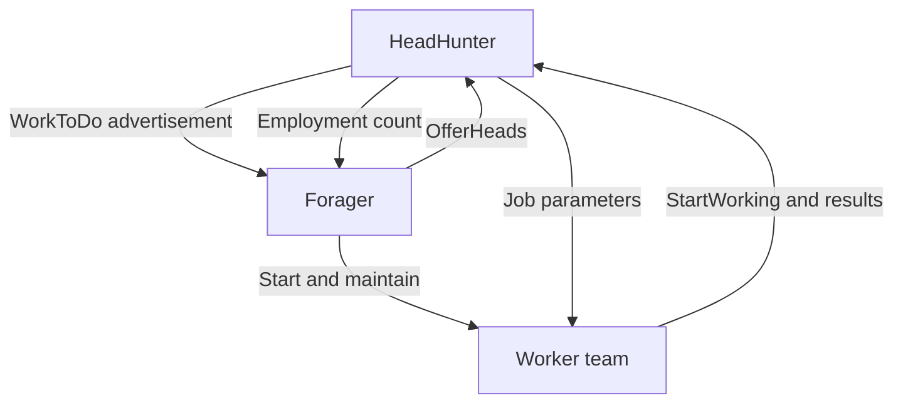

# Actors and typed chan: network and cluster research

Research revision: 1 · 2026-11-23

## Design authority

[D-32](DesignAuthorityRegistry.md#d-32) records this user-directed research.
[D-10-ACTOR-CHAN](DesignAuthorityRegistry.md#d-10-actor-chan) owns the confirmed
[Actor and chan boundary](SymbolicDynamicScope.md#actor-concurrency-direction): language terminology,
one dedicated OS thread per Actor, isolated dynamic context, static message typing and fire-and-forget
sending except for reported systemic communication faults. The
[human decision](../CHANGELOG.md#h-actor-chan-boundary-20261123) records the scope and its exclusions.

The remaining interfaces, ownership transitions and application protocols below are research
candidates, **pending-human**. P-703 records their dependencies; P-704 retains a candidate value path
through C-01/C-02/C-52 and the charter's separation of program, execution and interpretation
(§§3.2–3.3/6.1–6.3). P-131–P-133 retain their existing qualification. The value is an inspectable
typed workload that can be placed locally or on a cluster without hiding storage, authority or
business completion behind a transport operation.

Preserve actual owners, same-region stored edges, callable placement, scoped dynamic bindings and
cleanup. This research selects no additional syntax, transport, reliability protocol, scheduler
policy or implementation. Acceptance is the scenario matrix below. The
[continuity record](../CHANGELOG.md#k-actor-chan-research-20261123) identifies the source baseline and
the older execution and send-result candidates replaced by the new decisions.

## Confirmed basis

The language calls its independently executing entities **Actors** and its message communication
facility **chan**. OS processes and OS threads describe implementation resources. Each Actor has one
dedicated OS thread, its own execution stack and isolated TLS bindings. Several Actors may reside in
one OS process, but they do not share an execution thread. This design does not multiplex Actors onto
a worker pool or migrate an Actor between OS threads. Stack capacity and native ABI are separate
implementation details.

A chan has a **statically checked message type**. Sender and receiver code must satisfy that type's
contract. A received wire representation still needs validation before it can become a typed value;
an address, method name or structurally similar payload does not establish its CoD type identity.
The spelling of the type constructor and the forms of sending and receiving endpoints remain open.

**Ordinary sending is fire-and-forget.** The facility does not guarantee reception and supplies no
delivery receipt or acknowledgement. The sender must receive a system-fault report when the system
has grounds to judge that subsequent sends are likely to fail. An individual lost message, rejected
job or failed computation is not automatically such a systemic fault. The detection criteria,
reporting point and error representation remain to be specified.

Applications establish any stream, ordering, acknowledgement, retry, duplicate handling or other
reliable protocol they require. A reply is another application message with its own delivery risk.
This UDP-like semantic boundary does not mandate physical UDP or prohibit a selected transport from
using TCP and its internal retransmissions. Physical transport cannot strengthen the portable chan
contract into an implicit receipt or application-completion promise.

| Observation | Meaning at the confirmed boundary |
| --- | --- |
| A send completes without a system-fault report | The sender obtains no delivery or processing evidence and need not follow that individual transmission. |
| A systemic communication fault is reported | The communication facility has a fault expected to compromise subsequent sending; its precise scope and evidence need a contract. |
| A deadline expires while an application awaits a reply | The application has not observed the required reply; execution and external effects may already have happened. |
| A worker sends a result, refusal or cancellation response | This is an application protocol message, not a chan-generated receipt. |
| A connection closes | A transport observation. Its relation to an Actor, chan, in-flight work and system-fault reporting must be defined explicitly. |

## Reference baselines and method

The project user selected two existing applications as business context:

| Repository | Inspected default-branch revision | Role in this study |
| --- | --- | --- |
| [nedh](https://github.com/complyue/nedh/tree/04f5e0f62aabe656c21c3181edd9ba72c3f0c5b7) | `04f5e0f62aabe656c21c3181edd9ba72c3f0c5b7` | Network sessions, transport adapters, routed channels and request/reply workloads. |
| [sedh](https://github.com/complyue/sedh/tree/2567b52ed58985d0edfa6312a3b883c5cf8b79ab) | `2567b52ed58985d0edfa6312a3b883c5cf8b79ab` | Work-source discovery, resource recruitment, worker management, batch execution and result settlement. |

The findings below come from source inspection, including examples. They are not deployment or
performance measurements. A reference implementation is evidence for a workload and its existing
mechanisms; it does not approve a CoD API. Explicitly identified inconsistencies limit what can be
claimed from an example.

## What nedh contributes

### A connection, a route and a local execution context have different identities

A nedh `Peer` combines a connection's send/receive operations, end-of-life state, a channel map and
the environment in which incoming commands land. In the Haskell implementation the map is keyed by
an `EdhValue`. Text payloads and route expressions are evaluated; a directed result is written to the
selected BChan. Python similarly runs source in the supplied globals/locals. An undirected command
returns its result from the landing operation; it is not evidence of another dedicated inbox.
[Haskell Peer](https://github.com/complyue/nedh/blob/04f5e0f62aabe656c21c3181edd9ba72c3f0c5b7/host.hs/src/Language/Edh/Net/Peer.hs#L18-L110) ·
[Python landing](https://github.com/complyue/nedh/blob/04f5e0f62aabe656c21c3181edd9ba72c3f0c5b7/host.py/nedh/peer.py#L94-L186)

For CoD, this motivates separate contracts for Actor identity, chan endpoint identity, network route
and the receiver's admitted program interpretation. A TCP connection must not silently become the
Actor's identity, nor may a route string establish authority to invoke an arbitrary procedure.
Candidate work messages should describe an admitted operation and its inputs. The receiver supplies
the handlers and live resources required for that interpretation. A code-carrying protocol would
need its own checking and admission boundary.

nedh's design note recommends locally managed objects and communication through channels, avoiding a
distributed object-reference lifetime protocol. That is useful business guidance for CoD's
region-local graphs and explicit cross-region identities. The note's wish to tolerate late messages
to retired channels is not uniformly implemented: the Haskell/Python lookup paths reject a missing
channel. These are different evidence levels.
[Distributed-concurrency note](https://github.com/complyue/nedh/blob/04f5e0f62aabe656c21c3181edd9ba72c3f0c5b7/DistConc.md)

### Transport framing and queue resources must be specified independently

The TCP micro-protocol sends a byte-length/directive header followed by payload bytes. WebSocket
uses a routing frame followed by a payload frame; browser MessageChannel uses MessagePort envelopes.
The UDP discovery path operates on individual datagrams. These adapters share an application purpose
without supplying one interchangeable framing or lifetime contract.
[TCP framing](https://github.com/complyue/nedh/blob/04f5e0f62aabe656c21c3181edd9ba72c3f0c5b7/host.hs/src/Language/Edh/Net/MicroProto.hs#L29-L93) ·
[WebSocket adapter](https://github.com/complyue/nedh/blob/04f5e0f62aabe656c21c3181edd9ba72c3f0c5b7/host.hs/src/Language/Edh/Net/WebSocket.hs#L294-L395) ·
[MessagePort adapter](https://github.com/complyue/nedh/blob/04f5e0f62aabe656c21c3181edd9ba72c3f0c5b7/host.js/nedh/mc.js) ·
[UDP advertiser/sniffer](https://github.com/complyue/nedh/blob/04f5e0f62aabe656c21c3181edd9ba72c3f0c5b7/host.hs/src/Language/Edh/Net/Sniffer.hs#L180-L249)

Queue behavior also differs. Haskell uses single-slot TMVars on the connection path. Python's client
uses a one-item inbound queue and an unbounded outbound queue; its comment explicitly notes that
outgoing packets can accumulate despite remote backpressure. The browser adapter publishes through
EventSink. A common channel name therefore does not establish a common buffering guarantee.
[Haskell connection queues](https://github.com/complyue/nedh/blob/04f5e0f62aabe656c21c3181edd9ba72c3f0c5b7/host.hs/src/Language/Edh/Net/Server.hs#L207-L295) ·
[Python queues](https://github.com/complyue/nedh/blob/04f5e0f62aabe656c21c3181edd9ba72c3f0c5b7/host.py/nedh/client.py#L87-L100) ·
[Browser channel publication](https://github.com/complyue/nedh/blob/04f5e0f62aabe656c21c3181edd9ba72c3f0c5b7/host.js/nedh/ws-client.js#L145-L167)

CoD needs a resource policy for retained bytes, message counts and disposal. That policy must fit the
confirmed feedback boundary: occasional discard does not turn into a per-message negative receipt.
Application credits or windows may regulate offered traffic. They do not remove the runtime's duty
to bound or account for its own retained resources, and they do not select the basic queue policy.

### Reply endpoints and shared collectors reveal ownership questions

In the web REPL, a session has a shared `cmdIn`. Each client creates a `cmdOut` and submits the pair
`(cmdSrc, cmdOut)`; the session replies through that supplied endpoint. This is a concrete reason to
study typed reply capabilities in request messages, rather than assuming one global response path.
[REPL request and reply](https://github.com/complyue/nedh/blob/04f5e0f62aabe656c21c3181edd9ba72c3f0c5b7/edh_modules/net/repl.edh#L145-L226)

The Factotum example lets multiple worker connections share `resultCollector` and uses
`dispose=false` so one connection's end does not close the shared collector. A sender, connection
owner, chan owner and party permitted to close it are consequently distinct roles. In contrast,
Python `Factotum.eval` reads a shared uplink without adding a per-request correlation identifier;
that operation alone does not establish safe pairing of concurrent requests.
[Shared collector](https://github.com/complyue/nedh/blob/04f5e0f62aabe656c21c3181edd9ba72c3f0c5b7/Tour/factotum.edh#L25-L68) ·
[Python eval](https://github.com/complyue/nedh/blob/04f5e0f62aabe656c21c3181edd9ba72c3f0c5b7/host.py/nedh/facto.py#L181-L185)

The CoD question is how a request expresses the permitted response type and a valid return route
without embedding a raw pointer into another Actor's region. Endpoint capabilities, correlation
identity, expiry and close authority require their own design. Reusing Edh's name does not adopt its
dynamic lookup, buffering, rendezvous or broadcast behavior.

## What sedh contributes

### Resource recruitment is separate from task execution

sedh's control centre manages node configuration and operational status. Scheduling is coordinated
by a HeadHunter for each work source and a Forager on each participating node. The Forager maintains
the worker team associated with a work-source connection. Its work-source key is derived from the
UDP source address, not from a durable job identity.
[Control centre](https://github.com/complyue/sedh/blob/2567b52ed58985d0edfa6312a3b883c5cf8b79ab/edh_modules/swarm/cc/server.edh#L28-L71) ·
[Work-source registration](https://github.com/complyue/sedh/blob/2567b52ed58985d0edfa6312a3b883c5cf8b79ab/edh_modules/swarm/forager/mgmt.edh#L229-L281)

The inspected path is:

1. HeadHunter advertises `WorkToDo`, including requested headcount, executable, working directory,
   work module and priority.
2. Forager reserves capacity and connects back with `OfferHeads`.
3. HeadHunter sends the employed count on the data channel; Forager starts the corresponding workers.
4. Each worker establishes a direct session with HeadHunter and announces `StartWorking`.
5. HeadHunter assigns a job's parameter pack. The worker executes `doOneJob`, reports settlement and
   sends a result or error through the application channels.

[Recruitment](https://github.com/complyue/sedh/blob/2567b52ed58985d0edfa6312a3b883c5cf8b79ab/host.py/sedh/headhunter.py#L181-L283) ·
[Team creation](https://github.com/complyue/sedh/blob/2567b52ed58985d0edfa6312a3b883c5cf8b79ab/edh_modules/swarm/forager/mgmt.edh#L55-L164) ·
[Worker protocol](https://github.com/complyue/sedh/blob/2567b52ed58985d0edfa6312a3b883c5cf8b79ab/host.py/sedh/worker/__main__.py#L52-L99)

The topology below describes those application roles; it does not map each role to a CoD primitive.

These are distinct protocol phases. An employment confirmation does not confirm a task's execution;
replenishing a worker team does not retry the lost worker's job. For CoD, both confirmations and
results would be typed application messages sent through chan, subject to the application's own
loss-handling policy.

### Scheduling policy belongs to the application workload

Forager's queue groups work sources by priority, with FIFO behavior within a priority bucket. Each
bucket has a configured capacity and may discard an old entry when full; repeated discovery offers
another chance to engage. HeadHunter's pending jobs and idle workers use FILO lists. The resource
being recruited is headcount, rather than a general memory/GPU/data-locality placement model.
[Work-source queues](https://github.com/complyue/sedh/blob/2567b52ed58985d0edfa6312a3b883c5cf8b79ab/edh_modules/swarm/forager/wsq.edh#L36-L180) ·
[HeadHunter state](https://github.com/complyue/sedh/blob/2567b52ed58985d0edfa6312a3b883c5cf8b79ab/host.py/sedh/headhunter.py#L94-L120)

The useful CoD workload is an independently typed resource-offer protocol coupled to a typed job
protocol. Priority, fairness, batching, placement and capacity reservations are application choices.
The Actor-to-thread mapping is already fixed; cluster scheduling should decide where work and Actors
are placed, without introducing a second language-level thread model.

### Failure, retry, settlement and stopping are separate events

The native worker launcher connects a socket and then fork/execs an OS subprocess, passing the socket
descriptor. Losing the management connection leads Forager to stop its worker team; the native
stop helper sends SIGKILL. This is an OS-process mechanism in sedh, not evidence for safely terminating
one CoD Actor's thread inside a shared OS process.
[Native worker lifecycle](https://github.com/complyue/sedh/blob/2567b52ed58985d0edfa6312a3b883c5cf8b79ab/host.hs/src/Language/Edh/Swarm/Worker.hs#L50-L124) ·
[Team stop](https://github.com/complyue/sedh/blob/2567b52ed58985d0edfa6312a3b883c5cf8b79ab/edh_modules/swarm/forager/mgmt.edh#L166-L185)

A HeadHunter job timeout closes that worker's peer. The code does not obtain a cancellation-completed
acknowledgement. Retry policy is separately selected; the inspected path has no durable job journal
or result-deduplication transaction. If an effect happened before a reply was lost, retry can repeat
it. This is a consequence of the path, not an asserted test result.
[Job timeout and retry](https://github.com/complyue/sedh/blob/2567b52ed58985d0edfa6312a3b883c5cf8b79ab/host.py/sedh/headhunter.py#L300-L409)

CoD needs to distinguish a cancellation request, observing a cancellation response, Actor exit and
completion of resource cleanup. Under fire-and-forget sending, even the cancellation request may
be lost. A stream or job protocol may provide a typed response stating exactly what has stopped;
that does not create a basic send receipt or undo earlier effects.

The examples include independent parameter-grid jobs, reuse of a HeadHunter over several batches,
and sessions retaining worker-local state. Shared working directories and preinstalled modules are
part of the deployment context. These motivate both short jobs and long-lived Actors; they do not
require each CoD Actor to occupy an OS subprocess.
[Repeated batches](https://github.com/complyue/sedh/blob/2567b52ed58985d0edfa6312a3b883c5cf8b79ab/host.py/sedh/demo/tt/__main__.py) ·
[Session workload](https://github.com/complyue/sedh/blob/2567b52ed58985d0edfa6312a3b883c5cf8b79ab/host.py/sedh/demo/session.py#L59-L130) ·
[Worker deployment](https://github.com/complyue/sedh/blob/2567b52ed58985d0edfa6312a3b883c5cf8b79ab/SmartSwarm/WorkerSetup.md#L1-L37)

### Reference inconsistencies are evidence limits

Current Python workers send `SettleResult`, and the Python HeadHunter exposes it as a settlement
callback; its old `result_ch.put` path is commented out. The Edh worker also sends `SettleResult`, but
the Edh HeadHunter does not declare that method. The Edh batch example returns `r` where the current
worker reads `res`. These paths need reconciliation before they can serve as runnable protocol
acceptance. They are reference-repository maintenance issues, not new CoD language decisions.
[Python settlement path](https://github.com/complyue/sedh/blob/2567b52ed58985d0edfa6312a3b883c5cf8b79ab/host.py/sedh/headhunter.py) ·
[Edh worker](https://github.com/complyue/sedh/blob/2567b52ed58985d0edfa6312a3b883c5cf8b79ab/edh_modules/swarm/worker/__main__.edh) ·
[Edh HeadHunter](https://github.com/complyue/sedh/blob/2567b52ed58985d0edfa6312a3b883c5cf8b79ab/edh_modules/swarm/headhunter.edh) ·
[Edh batch example](https://github.com/complyue/sedh/blob/2567b52ed58985d0edfa6312a3b883c5cf8b79ab/edh_modules/swarm/demo/batch.edh)

## Candidate CoD workload

Use a work-source Actor, a node-management Actor and two worker Actors, with one worker local and
one reached through a network adapter. Each Actor has its own dedicated OS thread and dynamic
context. The same business operation can be interpreted by a simulation worker or a live-service
worker without changing the operation's typed description. This exercises the charter's program /
execution / environment separation.

The following names describe **application message families**, not selected CoD declarations or
builtin messages. Fields are design questions made concrete for review.

| Application family | Intended contents | Decision exposed by the workload |
| --- | --- | --- |
| Resource demand / offer | Request identity, required capabilities, offered capacity and expiry | Resource reservation is separate from execution; offers and acceptances may need repetition or expiry. |
| Job request | Business job identity, attempt identity, admitted operation, typed inputs and response route | A new execution attempt must be distinguishable from a retransmission of the same request. |
| Job outcome | Job/attempt identity and a typed success or domain-failure payload | A received outcome needs application-defined settlement and duplicate handling. |
| Session operation | Session identity, operation and response route | Stateful interactions need a lifetime and sequencing protocol above chan. |
| Cancellation request / outcome | Job/attempt identity and the precisely reported stopping stage | Request receipt, stopped computation and completed cleanup are different observations. |
| Optional reliable-flow message | Flow identity, sequence, acknowledgement or credit | Reliability and flow regulation belong to the chosen application protocol. |

An outcome can use a domain sum to preserve alternative-specific payloads. Static typing must reject
an unrelated payload at a sending endpoint and constrain receiving code to the declared family.
The message-family type, regional representation, codec/schema version and endpoint authority remain
different checks. A version mismatch is not an invitation to execute a same-spelled remote function.

Request and response protocols should make their unknown state explicit. For example, after losing
a result the work source knows that no usable result has been observed; it does not know that the
attempt never ran. It may retry an idempotent operation, query a durable application record, wait,
or report uncertainty according to that job's policy. The language does not choose one policy for
all business operations.

## Ownership and execution constraints

### Messages carry admissible data and capabilities

An asynchronously retained message cannot contain a `here` body borrowing a sender activation or an
ordinary proc value. `here` remains bounded by synchronous use, and procedures are not storable
callable values. Sending a typed operation description lets the receiver invoke its own admitted
implementation. This must preserve the module interpretation and required dynamic bindings.
[Callable value kinds](CallableStorageAndHereAccess.md#callable-value-kinds) ·
[Explicit lifetime principle](GlobalVariablesDoneRight.md#explicit-lifetimes-without-closures)

Region-internal direct edges stay in one region. A return endpoint or external business identity
cannot be represented by an arbitrary direct pointer into another region. An intrinsic endpoint
carrier, or a checked ID and routing capability, needs a specific storage and transfer contract.
Readonly access alone neither freezes an entire graph nor grants a shared lifetime.
[Regional graph boundary](GraphGrainedMemoryManagement.md#relationships-between-regions) ·
[Independent access qualifiers](RegionalOwnership.md#independent-binding-and-target-qualifiers)

The 1:1 mapping isolates Actor bindings. It does not settle module initialization/shutdown ownership,
initial binding inheritance, publication of shared data, or native failure containment. An Actor
must not acquire access to another Actor's live lexical state merely because both run in one OS
process. Native foreign entry must preserve the Actor's context and live owners.

### Exclusive regional handoff remains a candidate

Exclusive whole-region handoff is a useful first candidate for a regional message. In one address
space a system owner can change without repairing internal graph edges. Remote transfer still has
byte transport, validation, compatibility and lifetime costs. Local release responsibility and
business-level execution identity are separate: releasing each local region exactly once does not
mean a job executes exactly once.

| Stage under the exclusive-handoff candidate | Required responsibility |
| --- | --- |
| Constructing the message | The sender holds the region and initializes the admitted root and graph. |
| Entering send / encountering a systemic fault | The exact consumption point and fault postcondition must say whether the source remains available, an intrinsic carrier returns ownership, or the runtime disposes of it. This is not selected yet. |
| Completed handoff | The sender's owning name is consumed and outbound sender access is revoked. The runtime holds the message until another holder receives it or it is discarded. |
| Ordinary loss or discard | The responsible holder releases the payload; the sender receives no individual delivery report and its old references do not revive. |
| Receiving and finishing | The receiving Actor obtains the agreed access and release responsibility; it releases the region or explicitly transfers it again. |

H-262 already fixes the consumed state of an ordinary source after a completed transfer. H-263 bounds
which old views remain usable under a new local holder; it does not revive outbound sender access.
H-170's returned-packet proposal has not selected the fault outcome. Owner-bearing carriers must
respect the intrinsic ownership boundary. Neither ordinary loss nor later receipt recreates a
sender-owned packet automatically.
[Post-send state](RegionalOwnership.md#post-send-state-without-implicit-null-dereferences) ·
[Holding and transfer](GraphGrainedMemoryManagement.md#actor-holding-and-transfer-review)

Message handoff also remains distinct from dynamic-resource replay. Capturing, hiding or restoring
an installed resource preserves its owner; it does not extract an owning packet. A receiving Actor
establishes the resources for its own work. Existing function permissions still apply: explicit-input
operations do not become procedural solely because they mutate memory or send a message, while a
function cannot use dynamic lookup or a proc call to bypass its permissions.
[Packet/resource distinction](GraphGrainedMemoryManagement.md#packet-transport-and-effect-resources-are-distinct-scenarios) ·
[Functions and explicit memory](SymbolicDynamicScope.md#function-region-state-access)

## Decisions to discuss next

The execution mapping, terminology, static message typing, absence of reception guarantees and the
system-fault feedback boundary are settled. The remaining questions should be evaluated against the
same workloads rather than reopening those decisions.

| Question | Candidate to examine first | Alternative or boundary that must be evaluated |
| --- | --- | --- |
| Who may receive from a chan? | One receiving Actor, with independently distributable sending capabilities; an Actor may use several typed chans. | Multiple receiving Actors require a defined selection and ownership rule. Neither form is chosen by the name chan. |
| How does a request carry a reply endpoint? | A typed sending capability with explicit lifetime/revocation behavior. | A checked logical route plus response type may be enough; carrier placement and network authority must be specified. |
| Who owns a message after a systemic send fault? | Compare the existing returned-owner proposal with a consuming-and-disposing operation and a pre-transfer rejection path. | Decide the exact transfer point, source availability, error surface and validity of prior views. No default is selected here. |
| What faults justify reporting? | Classify persistent local endpoint/route/service failures using concrete evidence and scope the report to the affected facility. | Define whether and how remote observations contribute, when a recovered facility becomes usable, and how transient loss remains fire-and-forget. No probability threshold is implied. |
| What bounds queued resources? | Explicit runtime resource accounting and a bounded retention policy. | Choose full-queue handling, local resource waits, ordering and message-size limits without adding reception acknowledgements. |
| Who can close a chan, and what does close do? | A distinct owner/close capability; account for queued data and blocked receivers. | Specify late sends, drain/discard, shared collectors and the relationship to Actor termination. |
| How does an Actor stop? | Examine cooperative stopping and defined interruption points, with explicit cleanup and application cancellation messages. | Arbitrary native-thread termination, native faults and uninterruptible foreign calls need their own boundaries; sedh's subprocess SIGKILL is not that contract. |
| How do Actor startup and shared modules interact? | Separate Actor-local dynamic context from module semantic identity and already established module lifetimes. | Decide module initialization, shared resources, Actor entry requirements and final OS-process shutdown without implicit per-Actor module duplication. |
| What crosses a network boundary? | An admitted typed payload and checked route with explicit version/codec dependencies. | Decide byte format, authentication/capabilities, compatibility and size limits; zero-cost regional relocation does not choose a wire ABI. |

The one-receiver candidate follows the REPL and result-collector workloads particularly well. It is
a recommendation to investigate, not an approval of MPSC semantics or a chan API. Likewise,
cooperative cancellation is a candidate whose behavior must be reconciled with ordinary exceptions,
deferred cleanup and blocking/native operations before implementation review.

## Acceptance scenarios

These are design acceptance workloads, not a test suite or a claim of implemented behavior.

| Scenario | Observation required before the associated scope can be accepted |
| --- | --- |
| Two Actors in one OS process | Two dedicated OS threads; distinct bindings for the same symbol; each Actor observes its own installation and restoration. |
| Static payload mismatch | An incompatible message is rejected by the source type contract; an invalid external representation never becomes an admitted typed value. |
| A deliberately lost message | Ordinary send remains fire-and-forget; all retained payload storage is accounted for, without a synthesized receipt or sender-view revival. |
| A continuing communication fault | The selected fault policy reports the system condition to the sender; the ownership outcome is derivable and a later recovery has defined behavior. |
| A request carrying a reply route | The response type and sending authority are correct; the response endpoint can expire without retaining a caller frame. |
| Two workers sharing a collector | One worker's connection or Actor termination cannot close a collector owned by another party without the chosen authority. |
| A regional graph sent before sender scope exit | On the admitted delivery path, the receiver can use the graph after that scope ends; sharing/cycles survive and stale sender access rejects. |
| Loss after business effects but before an outcome arrives | The application distinguishes an unknown result from non-execution; its retry/settlement protocol defines duplicate effects. |
| Cancellation racing with a result | Application identities determine what each response means; no cancellation request alone proves cleanup or effect reversal. |
| Full queue, close and receiver exit | The selected policy accounts for queued messages, late senders and waiting receivers without leaks or accidental reliability promises. |
| Local and remote execution of one job description | Type and interpretation obligations hold in both contexts; physical transport and application reliability retain separate contracts. |

Start by closing the chan endpoint, ownership-on-fault and resource/close questions against a local
two-Actor trace. Then apply the same contracts to the REPL reply route and shared collector. The
cluster workload can add discovery, recruitment, attempt identities and settlement above that
boundary. This progression keeps the research grounded in nedh/sedh while preserving the CoD
decisions already made.
