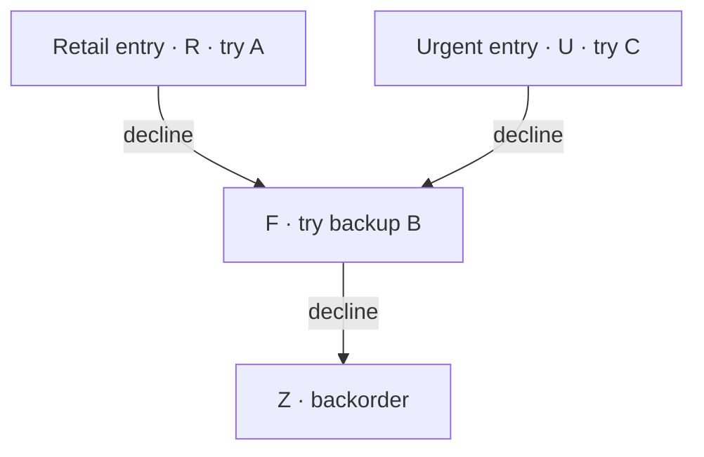

<a id="algebraic-effects-is-all-you-need"></a>
<a id="do-source-and-graph-edits-agree-on-an-effectful-policy"></a>

# Editing the Source Graph of an Effectful CoD Program

## Abstract

A fulfillment planner reserves warehouse B for urgent orders. Both retail and urgent orders currently reach the same fallback node in the published program. Changing that node would change both policies. Changing one incoming edge would implement the planner's request. This distinction is visible in the program's source: a DCG held in a CoD region. There may be no fully equivalent program in an ordinary textual source language. We develop a workflow in which a person inspects a bounded two-dimensional view, an AI assistant writes a CoD program to edit a private successor, and a reviewer checks which edge changed, which entry points it affects and which inventory requests each entry can issue. The hard question is whether the reviewer can discover a well-typed change with the wrong business scope, including when a consequential use lies outside the visible drawing. The warehouse example specifies that question precisely enough to try the workflow and to recognize a failure.

<a id="1-a-program-that-takes-a-program-as-its-input"></a>

## What it means to edit the source

The source of the warehouse policy is a DCG, a directed graph that admits cycles. Node alternatives, typed edges, shared targets and named entry points are explicit in the regional source. An editor can select and compare these entities directly. Its regional representation can preserve a join where two callers share an operation, or a back edge where the domain vocabulary admits one. A disk-backed memory region (DBMR) can publish a revision of that graph for subsequent readers. A warehouse executor interprets it. A CoD editor takes it as input and constructs a revised source graph as its result. A later invocation of the executor uses the revision.

In explanatory notation, the editor accepts and produces a `Program<Orders → Decisions>`. The program itself takes orders to shipping decisions under a reservation effect. The editor therefore returns a program of the same domain type with intentionally changed behavior. This notation describes the interface of the example. The CoD source below uses the domain's concrete regional schema.

A reader can use text to inspect a node or write the CoD editor as text. A fragment that reads “try B, otherwise backorder” can describe a node's behavior while omitting that two named entries reach that very node. A complete graph exchange format, where provided, owes its reader the roots, sharing, cycles, bindings and pinned dependencies needed to reconstruct the promised graph identities and semantics. Such an exchange may use textual node declarations and explicit edge identifiers even when no equivalent ordinary CoD source program exists. A partial reading view can explicitly mark omitted relationships. A CoD editor can still operate on the original regional source in either case. [Graph identity, sharing and execution](../design/RegionalSemanticPlatformCharter.md#33-图共享不等于执行共享) · [Readable views and complete exchange](../design/RegionalSemanticPlatformCharter.md#82-可读视图与完整交换形式)

<a id="2-one-executor-one-dsl"></a>
<a id="making-invalid-states-unrepresentable-in-the-stored-program"></a>
<a id="the-policy-and-its-executor"></a>

## Two entries share one fallback

The fulfillment DSL has two node alternatives. At a `TryWarehouse` node the executor requests a reservation at the named warehouse. On acceptance it ships from that warehouse. On decline it follows the node's outgoing reference. A `Backorder` node records an unfilled order. The only shipping warehouse available to this executor on success is the warehouse in the current node. The guarantee assumes the handler reports the outcome faithfully. A separate shipping destination field would let an editor introduce “reserve at A, ship from B.”

The application graph has two named entry roots. The names `R`, `U`, `F` and `Z` below identify nodes in the example revision. The view shows both entries and every decline edge reachable from them. Acceptance is terminal at each warehouse and is omitted from the drawing.



There is one F with two incoming edges. If a retail order and an urgent order both reach it, each execution issues its own reservation for B. Node sharing preserves program structure. Each invocation brings its own order, current position and effect occurrence. A second warehouse adapter or a simulator can supply a different interpretation of the reservation operation for a separate run. [Program, instance and environment](../design/RegionalSemanticPlatformCharter.md#32-程序执行实例与环境分离) · [Typed DBMR programs](../design/SymbolicDynamicScope.md#typed-dbmr-programs-and-domain-vocabularies)

The planner asks, **“Stop retail orders from trying B. Keep B available to urgent orders if C declines.”** The intended edit redirects R's decline edge from F to Z. U still points to the original fallback within the successor, and F still points to Z. This small case is acyclic. A source viewer should be able to display a back edge once and navigate it by identity. Whether a particular executor admits a cycle and what execution means in that DSL require separate rules. The warehouse executor considered here accepts acyclic reachable routes.

<a id="3-what-the-business-programmer-writes"></a>

## What a two-dimensional view can establish

Selecting F should reveal its declared operation, warehouse and incoming relationships. Selecting R's decline edge should identify R, the field being changed, the old target F and the proposed target Z. A before-and-after overlay can show R's prospective path while keeping the urgent path visible. A reviewer can expand the two neighborhoods, follow a reference to its target and ask for other uses of a node. These bounded operations make the business choice legible on a small screen.

A drawing can be incomplete. Suppose the viewer is filtered to retail orders when the reviewer selects F. F now has one *visible* incoming edge. If the tool knows the full dependency set, it should state that the urgent edge is hidden and let the reviewer inspect it. If another importing revision or domain has not been examined or the reviewer cannot see it, the tool must identify that limit before making a claim about the whole affected population. Canvas coordinates, node color and a count of visible arrows supply no stable source identity. A dragged edge, if supported, can prepare the same source-edit operation for review. A layout change alone has no effect on the published program.

Some changes require more than selecting a neighborhood. “Change only the retail decline for policies that still share this fallback with an urgent entry” is a predicate over the graph and its revision. A CoD program can inspect roots and targets, check this precondition, make the corresponding change and report the outcome. A two-dimensional viewer can expose the operation and its consequences while the language supplies iteration, identity comparisons and typed updates.

<a id="4-the-program-edit-and-the-business-result"></a>
<a id="appendix-the-warehouse-revision-in-cod"></a>
<a id="the-stored-editor"></a>

## A CoD program that changes one edge

The following example gives the vocabulary and the part of the editor that mutates a private draft. It uses nominal sum alternatives, named region roots, same-region references and the established reference-identity operation. Numeric IDs 1, 2 and 3 designate warehouses A, B and C in this fixture. A production vocabulary would draw its warehouse identities from its domain package. [Named sum constructors](../design/DomainLanguageDesign.md#named-sum-constructors) · [Named region roots](../design/GraphGrainedMemoryManagement.md#named-root-access-and-receiving-specifications) · [Reference identity](../design/RegionalAndLexicalStorageRefactor.md#reference-identity-and-the-is-operator)

```cod
data RouteNode =
    TryWarehouse { warehouse:u64; ref on_decline:RouteNode; }
  | Backorder {};

region Routing { ref retail:RouteNode; ref urgent:RouteNode; }

proc reserve_backup_for_urgent(region draft:Routing) {
    ref retail = draft.retail;
    ref urgent = draft.urgent;
    assert retail is not urgent;
    assert retail isa TryWarehouse;
    assert urgent isa TryWarehouse;
    assert retail.warehouse == 1u64;
    assert urgent.warehouse == 3u64;

    ref backup = retail.on_decline;
    assert backup is urgent.on_decline;
    assert backup isa TryWarehouse;
    assert backup.warehouse == 2u64;
    ref stop = backup.on_decline;
    assert stop isa Backorder;

    retail.on_decline = stop;
}
```

The assignment changes a stored reference field in the selected retail node. All the comparisons of target identity take place within the private draft. The equality check on `backup` would fail for two separately allocated, equal-looking B nodes. The checks also fail if retail and urgent have become the same entry target: changing that record would affect both. The routine assumes a validated input conforming to the two-entry fixture, including the acyclic routing rule. The checks in the routine cover the requested edit. The surrounding workflow must check the permitted *write set*, including changes outside those two paths if the source contains additional data.

The caller pins the published base revision and forks its reachable graph into a fresh writable region through a domain graph-transfer operation that preserves sharing. A borrowed target in the published base cannot become a stored physical edge in the draft. Between revisions, selected nodes must be related by the editor's recorded correspondence or a domain identity whose scope is declared. Two independently opened regions have distinct actual owners even when they represent corresponding policy nodes. The rectangular labels in the figure illustrate this correspondence without fixing an ID format. [Explicit graph transfer](../design/DomainLanguageDesign.md#dl-03) · [Checked owner and locator identity](../design/RegionalAndLexicalStorageRefactor.md#reference-identity-and-the-is-operator)

An AI assistant can generate the CoD routine from the planner's request and the inspected node relationships. Before it runs, the workbench supplies only the pinned input, a writable draft and the declared editing operations required for the task. The separately maintained checker should verify the resulting graph and compute its changes against the base. A preview can evaluate the old and new policy with a trace-recording reservation fixture. These are proposed workbench capabilities. Being able to write CoD source does not confer inventory credentials. The review record must say which capabilities the editor and preview actually received. [Authority and review](../design/RegionalSemanticPlatformCharter.md#103-权限审阅与执行分离)

<a id="5-why-algebraic-effects-belong-in-this-account"></a>
<a id="the-program-edit-and-the-business-result"></a>
<a id="allocation-and-independent-reporting"></a>

## What the planner can check

The graph edit can be checked before either policy runs. A reviewer then needs independent evidence connecting the change in source to the requested change in fulfillment. A trace fixture supplies replies by order and warehouse. The table below gives **expected observations** for fresh runs of each revision. “Backorder” is a terminal decision. Each listed warehouse letter denotes one actual request in that run.

| Entry and fixture replies | Published base | Proposed successor |
| --- | --- | --- |
| Retail. A accepts. | Ask A. Ship from A. | Ask A. Ship from A. |
| Retail. A declines and B would accept. | Ask A, then B. Ship from B. | Ask A. Backorder. |
| Retail. A and B would both decline. | Ask A, then B. Backorder. | Ask A. Backorder. |
| Urgent. C declines and B accepts. | Ask C, then B. Ship from B. | Ask C, then B. Ship from B. |
| Urgent. C and B decline. | Ask C, then B. Backorder. | Ask C, then B. Backorder. |
| Urgent. C accepts. | Ask C. Ship from C. | Ask C. Ship from C. |

The two retail-decline rows distinguish a changed output from an eliminated service call. The urgent rows distinguish “reserve B for urgent work” from deleting B for everyone. A reporting client can read order IDs and shipping decisions without permission to reserve stock. To review the eliminated request even where both policies backorder, the reviewer also needs the effect trace. A reservation failure before a normal reply takes neither the acceptance action nor the decline edge. If the service committed before a reply was lost, the true inventory change can be unknown to the planner. The graph edit makes no promise to undo it.

Algebraic operations and their interpretations explain why the same policy can be previewed against a recording fixture and later used with live inventory. A direct interpreter supplied with an explicit reservation service could produce the same trace for this vocabulary. Which CoD binding discipline to use in a particular executor is a separate design choice. The point of both runs is that the reviewer can observe exactly which operations the revised source requests. [Plotkin and Pretnar, *Handling Algebraic Effects*](https://arxiv.org/abs/1312.1399) · [CoD callable effects](../design/SymbolicDynamicScope.md#definition-installed-effectful-procedures)

<a id="6-native-execution-and-interactive-revision"></a>
<a id="one-session-two-policy-revisions"></a>

## Review and publish the successor

A proposed review record can be short enough to read during a change review. The values below describe the fixture and the requested outcome. A real review must derive them independently from the draft produced by the editor.

| Evidence | What the review should show for this edit |
| --- | --- |
| Request and base | The planner's retail-only instruction, the pinned policy revision and the two entry roots considered. Record which imports, callers and graph portions the impact check covers. |
| Graph change | R's `on_decline` changes from F to Z. U's target is still F. F still names B and declines to Z. The original source graph and the candidate have an explicit node correspondence. |
| Type, identity and authority | Every stored edge selects a valid same-region target of the declared type. The draft retains both roots. The edit used draft write access. The preview used a fixture handler with no live reservation capability. |
| Business consequences | For urgent orders, the ordered reservation requests and outcomes agree. For retail orders that A declines, the B request disappears. Include both rows where the final decision changes and rows where it agrees. |
| Conflict and publication | Compare the request's expected revision with the selected current base if the application maintains such a selection. Publish the validated private draft under a fresh name. Record the resulting revision and the base that a still-running execution uses. |

CoD's confirmed DBMR publication contract installs a complete new image only when its chosen final name is absent. Existing readers can retain their old version. Detecting that somebody changed the application's selection of the current policy requires an additional revision precondition. A proposed edit prepared against yesterday's base must be rechecked against today's selection before it can become the merchant's active policy. An occupied publication name, an ambiguous correspondence or an unacceptable capability leaves the reviewed operation incomplete. The reviewer should still be able to identify the previous policy and the reason publication or activation failed. [Fresh-name DBMR publication](../design/ConstructionAndAcquisition.md#publishing-a-newly-created-dbmr) · [DBMR version completion](../design/ConstructionAndAcquisition.md#building-and-maintaining-dbmr-versions)

<a id="7-what-we-can-show-and-what-to-measure"></a>
<a id="8-related-work-and-the-scope-of-the-claim"></a>
<a id="conclusion"></a>

## Where the proposal can fail

Ask two teams to implement the *same* retail-only request starting from the same graph. Provide one with a typed domain-specific graph editor and an explicitly supplied service. Provide the other with the bounded two-dimensional inspection and a CoD editing program, which its authors can develop with AI assistance. Give both teams the same independently specified checks, input graphs and read/write permissions. Have a reviewer who did not write either editor inspect the resulting change records. The interesting observation is whether the reviewer can justify the scope of a change in a graph they did not construct.

Introduce a candidate that redirects both entry edges and another prepared against an older revision in which retail had its own private fallback. Each can appear plausible in a retail-only view. The first changes the urgent trace. The second can pass ordinary type checking while violating the base or sharing preconditions. As a separate control, export and reopen the *unedited base* through a tool that reconstructs one equal-looking B node per entry. All its execution traces can agree with the original base. Now request a change to the single shared fallback. The original has one target with two users. The reconstruction offers two targets, so silently changing just one would change the wrong set of future executions. Include a valid revision and a sharing-preserving reopening as positive controls. Rejecting every proposal gives the planner no workable editing route. For larger or partially hidden graphs, the correct response may be to narrow the claimed impact until the required evidence is available.

Hyper-code already explored editing and evaluating persistent programs with explicit links to code and data. A typed domain-specific editor can also detect all three faulty changes. The CoD research question is whether ordinary CoD editing programs, guided by a readable view and independently checked against a human's scope, let those guarantees carry across new domain vocabularies without a bespoke graphical command for every transformation. Where the policy author needs a complete textual notation, its preservation of identity and sharing deserves a separate check. Where the regional DCG is the only complete program source, the test is whether a reviewer can establish exactly what the CoD program changed in that graph. [Zirintsis, Kirby and Morrison, *Hyper-code revisited*](https://research-portal.st-andrews.ac.uk/en/publications/hyper-code-revisited-unifying-program-source-executable-and-data/)
