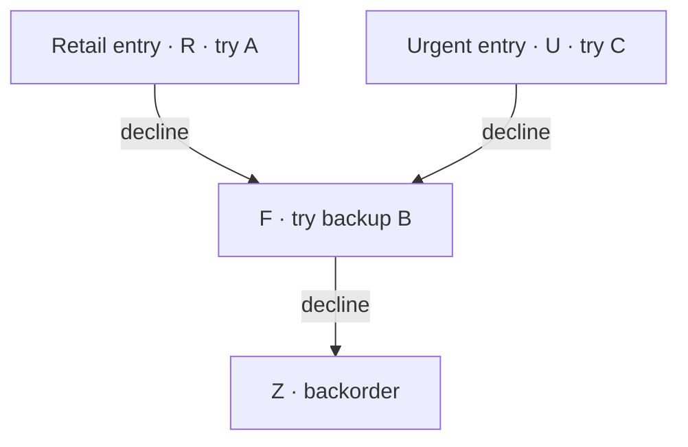

<a id="algebraic-effects-is-all-you-need"></a>
<a id="do-source-and-graph-edits-agree-on-an-effectful-policy"></a>

# Algebraic Effects Is All You Need

**Software Defined HLVMs**

## Abstract

A fulfillment team wants its planners to write routing policies. A publishing team wants
its editors to write release policies. Each application author should be able to build a
domain-specific High Level Virtual Machine (HLVM) in CoD, choose its instructions and
effects, and offer business users a **Domain Specific Graphical Programming Language**
for that machine. A planner can draw a warehouse fallback, ask an AI assistant to change
one route, and inspect the resulting reservations. An editor can put an approval step
before publication and preview which edition would be released.

The programs are typed directed graphs admitting cycles (DCGs), stored in relocatable
regions. An instruction is a functor in the C++ sense: a data object with a call
operation. Its operands and regional edges travel with the program. Its domain-defined
method executes in a compatible machine and can request effects supplied by the current
environment. This separation lets many teams define Software Defined HLVMs on shared CoD
infrastructure. Their authors can publish common ontology types in a CoD package, consult
one large, rarely revised ontology through shared read-only DBMR opens, and retain types
and operational databases specific to each domain. The
research question is what each new DSL costs its *language author* to
build, what it costs a *domain user* to author and safely revise one business program, and
how that program performs. We derive example traces and give separate tests for all three.

## Who defines the language, and who writes the program?

The fulfillment application author designs a language of attempts, warehouse choices and
decline routes. They define the node types, required operands, legal connections, result and
fault contracts, node methods and reservation handler interface. They decide what the
planner sees on the canvas and which domain checks explain a mistake. These decisions give
the graphical notation a grammar and an execution semantics. Connecting the *decline*
port has a meaning even if the editor is closed and the graph is reopened elsewhere.

The planner authors a program in that language. They choose the entry for each order
class, pick warehouse operands and connect the fallback routes. An AI assistant can
propose a subgraph or write a CoD transformation of an existing graph. The planner
reviews the actual nodes, connections and effect trace against a fulfillment requirement.
The platform contributes regional storage, checked access, scoped effects and native
execution. Application authors retain control over the vocabulary and its evolution. A
test of this division of labor is whether another team can introduce its own node types,
editor vocabulary and executable meanings using the same platform with no central list
of business instructions to update.

| Work product | Fulfillment application author | Fulfillment planner |
| --- | --- | --- |
| Language and machine | Define `TryWarehouse` and `Backorder`, the type of a route target, the reservation operation and its interpretations. | Use those instructions and choose a permitted warehouse. |
| Graphical authoring | Give the decline edge a named port, define checks for both entry roots, and show where a shared fallback is also used. | Create a route, connect a decline port or ask the assistant to make a checked edit. |
| Business acceptance | Specify faults and supply a preview environment with service-reply fixtures. | Read which requests the candidate would issue, examine unaffected orders and approve a program revision. |

The platform goal therefore concerns the economics of building and using **business DSLs**.
A fair comparison gives a textual DSL or another graphical language workbench the same
business vocabulary, service contract and test cases. LLVM answers the separate question
of how to implement and optimize the native machinery the domain machines can share.
[CoD platform charter](../design/RegionalSemanticPlatformCharter.md) · [MPS language structure, editors and actions](https://www.jetbrains.com/help/mps/mps-project-structure.html)

## The instruction is a regional functor

Consider one instruction, `TryWarehouse(B, fallback)`. A warehouse programmer can inspect
its operand B and follow its decline edge. At run time, invoking the node means asking for
a reservation of the current order at B. Acceptance yields a shipping decision for B.
Decline transfers control along the edge. A service fault follows the handler's failure
contract. The inventory call is the effect. The decision about what to do with its answer
belongs to this instruction. `Backorder` is a second instruction which finishes without
requesting inventory. Recording the warehouse once ensures an accepted reservation at B yields a shipping
decision for B.

| What has to survive | What supplies it in the warehouse machine |
| --- | --- |
| The program, across opens and executions | A typed disk-backed memory region (DBMR) contains entry roots, node alternatives, their operands and same-region references. Multiple incoming edges can name the same receiver. |
| The meaning of an instruction | The executor's selected module world provides the nominal receiver's call-operator methods. A method specialized on the active sum alternative can implement one instruction. |
| An execution of an order | The active invocation supplies the order, position or call stack, and selected bindings. Thousands of orders can enter one read-only image. |
| The authority and outcome of `reserve` | An installed handler in that execution context may call an inventory service, consult a simulator, or return scripted replies and record requests. Each interpretation owes its caller its declared contract. |

The functor is ordinary initialized regional **data that admits a call**. In CoD, `r(args)`
selects the visible `(())` family of the nominal receiver at the call site. Within that
family an alternative-specific method can read its receiver's fields. An effectful method
has `proc` permissions. The bytes of the receiver do not include a process-local method address, a C++ vtable
pointer, a lexical callable view or an installed handler. Persisting the object in this
sense makes no claim about copying arbitrary C++ object representations. [CoD call-operator lookup](../design/DomainLanguageDesign.md#type-level-call-operator-lookup) · [Callable storage and access](../design/CallableStorageAndHereAccess.md#what-an-invocation-needs) · [C++ function objects](https://eel.is/c++draft/function.objects)

Here is a small CoD rendering of the instruction set for a service that returns a normal
Boolean answer. In this fixture the three valid warehouse IDs are positive, and zero denotes
backorder in the result. A domain package could give that result its own sum type.

```cod
data RouteNode =
    TryWarehouse { warehouse:u64; ref on_decline:RouteNode; }
  | Backorder {}

region Routing { ref retail:RouteNode; ref urgent:RouteNode; }

symbol @reserve:proc(order:u64, warehouse:u64) -> bool

proc (const TryWarehouse in O).(())(order:u64) -> u64 where {const owner O} {
    if (behave @reserve(order, self.warehouse)) { return self.warehouse }
    ref fallback = self.on_decline
    return fallback(order)
}

proc (const Backorder in O).(())(order:u64) -> u64 where {const owner O} {
    return 0u64
}
```

Calling the retail root starts the program. The active alternative supplies the method.
Only the decline case calls the next receiver. An executor may implement the tail call by
updating a cursor. Acceptance returns the warehouse already present in the node. A live
service that can report a fault needs a corresponding failure contract and a propagation
path from the instruction. Fabricating a normal `false` reply would issue an extra request
on the decline route. The listing isolates the two normal replies so that this extension
can be tested independently. [Functor method permissions](../design/DomainLanguageDesign.md#functor-receivers-and-callback-arguments) · [Calling an installed operation](../design/SymbolicDynamicScope.md#lexical-selection-installation-and-invocation)

<a id="what-the-hlvm-shares-with-llvm"></a>

## What domain HLVMs share with LLVM

LLVM gives producers of low-level typed SSA programs a common representation and machinery
for optimization and native code generation. A domain-specific HLVM draws a corresponding
boundary at the level of a business instruction. A generator, an editor or a compatible
image loader can supply a warehouse program. The executor can consume any checked program
from that vocabulary. `TryWarehouse` retains its warehouse, effect contract and decline
edge at this boundary. Lowering it earlier would oblige every tool interested in the
business meaning to recover those relationships. MLIR's dialects already provide extensible
typed operations and lowering. The particular question for CoD is what follows when the
*executable domain program itself* remains a relocatable regional graph with owned data
receivers and execution-scoped effects. [LLVM Language Reference](https://llvm.org/docs/LangRef.html) · [MLIR Language Reference](https://mlir.llvm.org/docs/LangRef/) · [CoD architecture, sections 3 and 6](../design/RegionalSemanticPlatformCharter.md)

In CoD's planned architecture, LLVM supports native handlers and execution machinery. A
generic native executor can already consume a new graph in its vocabulary. A stable
combination of graph revision, mappings, handler contracts and target can also justify a
specialized path. A specialization which inlines a recorded interpretation must be
reselected or invalidated when the execution changes to live inventory. Every path owes
the business program the same requests, in order, for the same inputs and replies.
[Typed DBMR programs and native executors](../design/SymbolicDynamicScope.md#typed-dbmr-programs-and-domain-vocabularies)

| Change requested by the business | What must be supplied again |
| --- | --- |
| Keep B in reserve for urgent orders | Edit one edge, check and publish the new graph. The vocabulary, generic executor and inventory handler can all be reused. |
| Run the same published program in an inventory simulator | Bind a compatible simulator for this run. The program image and generic executor can be reused. |
| Add a timed hold with a distinct expiry reply | Extend the vocabulary, its interpretations and the affected builders and validators. Establish a compatible executor before admitting such an image. |
| Retarget native execution | Prepare methods and handlers for the target. Reopening an existing image requires compatible regional layout, schema and semantics on that target. |

“All you need” makes a sufficiency claim at a specified boundary. For this vocabulary an
order, the selected entry, compatible instruction methods and a reservation interpretation
determine the observable execution. We can test that claim by supplying two implementations
with the same sequence of service replies and comparing requests and results. An instruction
that also reads a hidden clock could distinguish the implementations. The clock would have
to appear as an input or an effect before the claim could cover it. The choice of inventory
consistency, retry semantics and permission to reserve still belongs to the application.
Interpretations can themselves use a lower-level effects vocabulary. For example, a live
warehouse adapter can interpret `reserve` by issuing an atomic conditional stock claim,
while a simulation interprets the request by updating a private inventory. Reading a count
and decrementing later would implement a different contract under competing orders.
The business contract must specify atomicity and faults. A design that offers persistent
continuations or multi-shot resumption would also need a representation and laws for those
operations. Following a decline edge can be specified with a single reply. The operations
and interpretations account follows the algebraic effects literature. The regional
representation and its costs are additional hypotheses. [Plotkin and Pretnar, *Handling Algebraic Effects*](https://arxiv.org/abs/1312.1399)

<a id="2-one-executor-one-dsl"></a>
<a id="making-invalid-states-unrepresentable-in-the-stored-program"></a>
<a id="the-policy-and-its-executor"></a>

## Two entries share one fallback

The planner can create the base program on an empty canvas. From the fulfillment palette
they place two `TryWarehouse` nodes, set their warehouse fields to A and C, and name them
as the retail and urgent entries. They add one `Backorder` terminal. They ask the AI
assistant, “Give both routes a single backup at B before backorder.” The assistant proposes
one new B node, binds both decline ports to that node, and connects its decline port to
the terminal. The proposer can use the same typed CoD graph operations available to a
manual editor. The planner inspects that B has **two incoming edges** and tests a decline
at C before publishing. Two copies of a B-shaped box would encode a different source
program even if both previews happened to ship the same orders.

The resulting program has four nodes. `R`, `U`, `F` and `Z` are labels for this revision.
The view shows both entries and all reachable decline edges. Acceptance is terminal at
each warehouse. The pictured graph is a program that the warehouse HLVM can execute.



There is one F with two incoming edges. If a retail order and an urgent order both reach it, each execution issues its own reservation for B. Node sharing preserves program structure. Each invocation brings its own order, current position and effect occurrence. A second warehouse adapter or a simulator can supply a different interpretation of the reservation operation for a separate run. [Program, instance and environment](../design/RegionalSemanticPlatformCharter.md#32-程序执行实例与环境分离) · [Typed DBMR programs](../design/SymbolicDynamicScope.md#typed-dbmr-programs-and-domain-vocabularies)

The planner asks, **“Stop retail orders from trying B. Keep B available to urgent orders if C declines.”** The intended edit redirects R's decline edge from F to Z. U still points to the original fallback within the successor, and F still points to Z. This small case is acyclic. A source viewer should be able to display a back edge once and navigate it by identity. Whether a particular executor admits a cycle and what execution means in that DSL require separate rules. The warehouse executor considered here accepts acyclic reachable routes.

<a id="5-why-algebraic-effects-belong-in-this-account"></a>

## Run and reopen the same program

Take an urgent order for which C declines and B accepts. Invoking U emits the request
`reserve(order,C)`. Its reply selects F. Invoking F emits `reserve(order,B)` and returns B.
Starting a second order at R can reach the same F and issue a fresh reservation. An
optimization that memoizes F's outcome solely by node identity changes inventory behavior.
Install a recording handler with fixed replies at demonstration time. At deployment the
live handler receives the same operation and arguments at each visit. Equal reply prefixes
give equal request prefixes. Different inventories can legitimately produce different routes.

For the acyclic fixture this can be shown by induction on the remaining path length.
`Backorder` finishes immediately with an empty request trace. A warehouse node emits
one request. A positive reply determines the final result. A negative reply reduces the
claim to its stored successor. A declared fault propagates at the visited node according
to the same contract. This reasoning covers equal results with *unequal* request traces
as a detectable error. It makes no assumption that the live handler rolls back an external
reservation after a lost reply.

Now publish the checked image and map it at another base address in a compatible reader.
The retail and urgent decline edges still denote the same regional target F. Relative
references preserve that fact without writing a fixup into every node. The new reader
supplies a matching executor, opens its own authority for the handler, and starts a fresh
invocation. Comparing traces for both entries at two base addresses tests execution as
well as graph preservation. Check shared-target identity directly too: duplicating F
could pass every current execution test while changing the meaning of a later graph edit.
A view obtained from a consumed owner cannot be used to access the graph under its new
owner. A fresh validated view belongs to the current owner. Page faults, validation,
format compatibility and native dispatch still have measurable costs. [Regional ownership](../design/RegionalOwnership.md#local-view-validity-after-ownership-transfer) · [Region representation and relocation](../design/GraphGrainedMemoryManagement.md#one-region-per-pointer-graph)

## A second domain team defines an editorial release language

A publishing application author supplies an input revision, a result type with alternatives
`WaitingFor(role)` and `Released(receipt)`, and two kinds of regional functor. These are
application-level definitions for this thought experiment.

| Instruction in the editorial language | What the method does |
| --- | --- |
| `RequireApproval(role, on_approval)` | Ask `approval(revision, role)` about this exact revision. Follow the stored edge when approved. A normal pending reply finishes this invocation with `WaitingFor(role)`. |
| `ReleaseEdition(channel)` | Ask `publish(revision, channel)` for a receipt. On success return `Released(receipt)`. A service fault follows the publication failure contract. |

The editor-in-chief starts a graph in this language, places a copy-desk approval before
a public release, then asks the assistant to insert legal approval between them. The
candidate contains two distinct approval nodes, each with one role operand, and a single
`ReleaseEdition(public)` node. In a preview of revision 17, set copy approval to granted
and legal approval to pending. The requests must be `approval(17, copy)` followed by
`approval(17, legal)`. The result is `WaitingFor(legal)` and the publication handler
receives zero requests. On a fresh run with both approvals granted, the preview records
one additional request, `publish(17, public)`. If it returns receipt 804, the result is
`Released(804)`. The fixture describes a fresh invocation on each run. Publishing twice
across independently repeated live invocations would require its own service policy.

The publishing team supplies its own data definitions, ports, callable methods, effect
interfaces and preview readings. Its business user can insert another existing approval
step without changing the language. A requirement to schedule a release for a time known
only at run time would need a new source of information and possibly a new instruction.
The fulfillment team's nodes, reservation handler and executor need no change in either
case. A platform implementation that requires the two teams to coordinate a global opcode
switch would fail the independence test. These teams can still agree on an ontology package
and consult the same published facts when they serve one business.

## Shared ontology packages and DBMR databases

Consider a publisher that issues facsimiles from a closed, national-scale collection
of historical print. A series of atlases is one small part of the collection. A warehouse
planner assembles sets of reproduced sheets. An editor approves the proofs for those same sets. Both
ask a bibliographic question before proceeding: **which pieces constitute this edition?**
A foldout bound between two plates can be essential even when it carries no page number.
Two editions with the same short title can require different sets.

The application authors import a common CoD package, `facsimile-ontology`. It defines
the identities of works, editions, volumes, sheets and plates, the relations between
them, and the catalog root type. The shared database instantiates that vocabulary with
canonical identities, historical title aliases, ordered constituents and provenance for
the cataloger's assertions. Billions of page occurrences, their links to volumes and
editions, and indexes for title and constituent queries give this workload its scale.
The large body of knowledge is the set of facts and relations. A small vocabulary can
describe it. A real point of reference is HathiTrust Research Center's Extracted Features
2.0 snapshot of February 2020, covering 17,123,746 volumes and 6,221,631,336 pages.
Those figures document the scale of a historical corpus. The facsimile ontology, sheet
requirements and CoD representation here are a proposed workload.
[HTRC dataset documentation and counts](https://htrc.atlassian.net/wiki/spaces/COM/pages/43295914)

| Who uses it | Package and persistent data | When its facts change |
| --- | --- | --- |
| Both machines | `facsimile-ontology` and the same published `facsimile-catalog` DBMR. Each program resolves an edition key to the catalog's list of required sheets. | The project pins a scholarly edition for a multi-year publishing series. An independently verified bibliographic correction can justify a new edition of the catalog. |
| Fulfillment HLVM | Its own types package, routing-program DBMR and private stock database record sheet lots, orders and reservations. | A shipment or reservation changes operational stock. The approved catalog continues to describe the same complete set. |
| Editorial HLVM | Its own types package, approval-program DBMR and private editorial database record proofs, sign-offs and publication receipts. | A new scan, approval or release changes the editorial record. It uses the same catalog to check the next set. |

**Shared read-only open is the normal CoD path for consuming a published DBMR.** Each
service validates and maps the selected image read-only, keeps its acquisition live,
and serves many queries before releasing it. Multiple processes can open the same image
at different addresses. Each acquisition has its own mapping and actual owner. Opening
and releasing the catalog write no files, including reader metadata. Each consumer
checks the expected root, compatibility and read access. Its program graph carries a
domain key and resolves it against the selected catalog. A view obtained this way is
valid under the actual owner of that opening. A replacement acquisition requires a new
lookup before using a view into the replacement. [DBMR modes](../design/ConstructionAndAcquisition.md#dbmr-modes) · [Domain integration](../design/RegionalSemanticPlatformCharter.md#4-多-domain多-region-的即时集成) · [Validity of views across owner transfer](../design/RegionalOwnership.md#local-view-validity-after-ownership-transfer)

For an order of one E42 facsimile, the approved catalog lists plates A and B and foldout
F. The warehouse policy checks the private lot for each required piece before issuing a
reservation for the set. The editorial policy checks that the proof for each required
piece has been approved before requesting publication. Both use the same E42 record.

| Private facts; same catalog image in both runs | Fulfillment result | Editorial result |
| --- | --- | --- |
| A, B and F are in stock. Only A and B have approved proofs. | Request one complete A/B/F set reservation. | Report the missing proof for F. Issue no publication request. |
| F is out of stock. All three proofs have now been approved. | Report a shortage of F. Issue no reservation. | Request publication once. |

Both changes in the second row are everyday work. They cause **zero catalog publications**.
Only a rare change to the bibliographic facts merits a new image. Suppose an authenticated
collation establishes that E42 also included an unnumbered key sheet K. A short-lived
builder opens the previous catalog read-only, constructs and validates the corrected
successor privately, then publishes it under a fresh name. Keep stock and approved
proofs fixed at A/B/F for this test. Readers pinned to the old edition still see a complete
set. Readers selecting the corrected edition must identify missing K before either
service call. Existing readers can keep using their original image throughout. This
example gives the shared ontology an edition cycle measured in years and operational
databases a cycle measured in orders and proofs. [DBMR version construction and publication](../design/ConstructionAndAcquisition.md#building-and-maintaining-dbmr-versions)

Importing the same type package also permits a rehearsal catalog with different contents.
Record the catalog identity and revision each machine opened. Run one consumer on each
edition to demonstrate the effect of mixed selection. An application that promises the
same knowledge to both selects the same published revision. Authority to read that
catalog grants neither stock-reservation nor publication authority.
[Typed identity and version selection](../design/DomainLanguageDesign.md#dl-08)

## A second instruction set with a cycle

The proposed `hlvm-basic` application supplies a small independent check. Let its frontend
resolve BASIC line numbers to instruction edges once. A counter lives in the execution
instance. `PRINT` emits an output request. A conditional branch selects an internal edge.
Consider this written input for the proposed fixture.

```basic
10 LET N = 2
20 PRINT N
30 LET N = N - 1
40 IF N > 0 THEN GOTO 20
50 END
```

A recording handler must see `[2, 1]` in order. Launch two instances from the same image
and each must produce that trace under its own counter and handler. Reopen the image at a
different base in a fresh, compatible process with the BASIC executor and without the
frontend. It should visit the shared print node twice and give the same trace. A console
handler can instead display the two values. Replacing the taken back edge with the edge
to `END` yields only `[2]`. Here the equivalent textual BASIC edit supplies an independent
control. This example needs only instance-local state, branches and a typed output effect.
Saving a running instance across a crash would additionally require an explicit account of
the remaining computation, its state and the status of external effects.
[Deferred BASIC application](../applications/README.md#deferred-application-hlvm-basic) · [Execution instances and persistent continuations](../design/RegionalSemanticPlatformCharter.md)

<a id="7-what-we-can-show-and-what-to-measure"></a>

## What low cost and high performance would mean

### Compare two ways to deliver the same business DSL

A textual route DSL can preserve the relevant source identities in this fixture. For
example, give each definition one node and let its name be a reference to that node. The
following is paper notation for a competing business language.

```text
stop         = backorder
backup       = try B on decline stop
entry retail = try A on decline backup
entry urgent = try C on decline backup
```

A planner can replace `backup` by `stop` in the retail entry alone. Give the textual
editor go-to-definition, find-references, the same AI access, and the same reservation
preview as the graphical editor. Both must keep urgent's B request, eliminate retail's B
request after decline, and preserve shared identities in the unedited program. Starting
from an empty program measures authoring. Revising a filtered or imported graph measures
whether a user can discover affected policies. Eclipse Sirius already lets domain
specialists work in modelers defined by application teams. Pair such a graphical
workbench with the same business executor and fixtures for
another peer on the same tasks. [Sirius architecture](https://eclipse.dev/sirius/doc/developer/Architecture_Overview.html)

Equivalence with the textual DSL can be checked for this small fixture even if a richer
DCG has no complete textual source language.

Before timing any program, ask a second application team to supply the
[editorial release language](#a-second-domain-team-defines-an-editorial-release-language).
Record the node schemas, effect signatures, methods, editor and checker code they supply,
what platform code they can reuse, and any central runtime changes the team requests.
Include the cost of the native methods implementing the instructions in each domain.
For the [historical facsimile catalog](#shared-ontology-packages-and-dbmr-databases),
charge ontology construction, indexing and publication once per catalog edition. Count
copied or rebuilt data and any integration work in each consumer. Measure cold validation
and open, first indexed lookup, and repeated lookups through a live mapping separately.
Vary the number of concurrent read-only consumers. Report the actual resident memory,
I/O and working set. A large image's mapped extent alone cannot predict those costs.
Compare a normal day of orders and proof approvals, with no catalog publication, against
the exceptional cost of issuing and adopting a corrected edition.
Then give practitioners unfamiliar with the implementations the same new-program
and change requests in each language. Record time to first correct policy, wrong-scope
edits accepted or caught, and which traces the user could explain. Count AI-assisted
work on the same terms in both arms. A saving in platform engineering, a saving in
business authoring and a saving in machine time answer three different questions.

### Compare execution paths with equal observations

Compare (A) a directly compiled CoD implementation of the same warehouse decisions, (B) a
native domain executor running the regional graph, and, if built, (C) an LLVM
specialization of B for a pinned configuration. Give all three the same inputs, handler,
reply stream, validation assumptions and observable trace. The generic executor is useful
even when specializing each revision would cost more than that revision's entire run.

| Workload | Quantities to report and failure it can reveal |
| --- | --- |
| Change only the retail decline edge | List which artifacts, packages and native components actually changed. Measure edit to first correct result, including validation, publication, loading and any recompilation. Rebuilding the generic executor for every such edit defeats this cost argument. |
| Fresh open of the same checked image | Record cold I/O, page faults, validation and first completed order separately. Test another base address and count per-edge repairs. A linear validation pass and a linear pointer-rewriting pass are different costs. |
| Warm execution with a deterministic in-memory handler | Measure time per visited node, requests per second, memory and code size. Vary path length, branch predictability, layout and instruction granularity. The cheap `PRINT` fixture can expose dispatch and locality costs that an inventory call hides. |
| Service-dominated execution | Supply the same service latency distribution to each path and report end-to-end latency separately. Record the ordered calls so that skipping a call cannot masquerade as speed. |
| Optional specialization | Charge compilation, extra code and invalidation as well as warm savings. At a saving of `d` time per order and a one-time cost `c`, a stable revision needs more than `c/d` orders to pay back compilation when `d > 0`. |

A low-cost, high-performance result would combine affordable new DSLs, inexpensive policy
revisions and competitive execution on stated workloads. The crossover between cheap branching and
coarse native operations matters more than a single peak throughput figure. These are
measurement designs. The traces in this paper are derived from the instruction contracts.

<a id="1-a-program-that-takes-a-program-as-its-input"></a>
<a id="what-it-means-to-edit-the-source"></a>
<a id="editing-the-source-graph-of-an-effectful-cod-program"></a>
<a id="3-what-the-business-programmer-writes"></a>
<a id="what-a-two-dimensional-view-can-establish"></a>

## Editing the source graph with CoD

The warehouse DCG can itself be the complete program source. There may be no ordinary
textual CoD program with equivalent source identities, shared nodes, cycles and bindings.
A readable projection can omit those details if it marks its boundary. A complete
exchange format would have to recover them. In paper notation the editor takes and
returns a `Program<Orders → Decisions>`. The executor subsequently runs the successor on
orders. Separating these two roles lets an AI help write a CoD editor without giving it
inventory authority. [Readable views and complete exchange](../design/RegionalSemanticPlatformCharter.md#82-可读视图与完整交换形式)

The planner's later request changes just one decline edge. The viewer should show the
field, its old and new targets and both incoming edges at F. If a retail-only filter hides
U, the planner can expand F's other uses or see how far the impact check actually reached.
A drag can propose one edge update. “Change only retail policies that still share their
fallback with urgent” requires a predicate over the graph. An AI-assisted CoD editor can
check that predicate in a private successor. Canvas positions supply no persistent node
identity. Domain-specific commands, direct graphical edits and programmatic graph edits
can all produce a reviewable change to the same program.

<a id="4-the-program-edit-and-the-business-result"></a>
<a id="appendix-the-warehouse-revision-in-cod"></a>
<a id="the-stored-editor"></a>

### A CoD program that changes one edge

The editor uses the instruction set defined above, checking the relevant identities before the write.
[Reference identity](../design/RegionalAndLexicalStorageRefactor.md#reference-identity-and-the-is-operator)

```cod
proc reserve_backup_for_urgent(region draft:Routing) {
    ref retail = draft.retail;
    ref urgent = draft.urgent;
    assert retail is not urgent;
    assert retail isa TryWarehouse;
    assert urgent isa TryWarehouse;
    assert retail.warehouse == 1u64;
    assert urgent.warehouse == 3u64;

    ref backup = retail.on_decline;
    assert backup is urgent.on_decline;
    assert backup isa TryWarehouse;
    assert backup.warehouse == 2u64;
    ref stop = backup.on_decline;
    assert stop isa Backorder;

    retail.on_decline = stop;
}
```

The assignment changes a stored reference field in the selected retail node. All the comparisons of target identity take place within the private draft. The equality check on `backup` would fail for two separately allocated, equal-looking B nodes. The checks also fail if retail and urgent have become the same entry target: changing that record would affect both. The routine assumes a validated input conforming to the two-entry fixture, including the acyclic routing rule. The checks in the routine cover the requested edit. The surrounding workflow must check the permitted *write set*, including changes outside those two paths if the source contains additional data.

The caller pins the published base revision and forks its reachable graph into a fresh writable region through a domain graph-transfer operation that preserves sharing. A borrowed target in the published base cannot become a stored physical edge in the draft. Between revisions, selected nodes must be related by the editor's recorded correspondence or a domain identity whose scope is declared. Two independently opened regions have distinct actual owners even when they represent corresponding policy nodes. The rectangular labels in the figure illustrate this correspondence without fixing an ID format. [Explicit graph transfer](../design/DomainLanguageDesign.md#dl-03) · [Checked owner and locator identity](../design/RegionalAndLexicalStorageRefactor.md#reference-identity-and-the-is-operator)

An AI assistant can generate the CoD routine from the planner's request and the inspected node relationships. Before it runs, the workbench supplies only the pinned input, a writable draft and the declared editing operations required for the task. The separately maintained checker should verify the resulting graph and compute its changes against the base. A preview can evaluate the old and new policy with a trace-recording reservation fixture. These are proposed workbench capabilities. Being able to write CoD source does not confer inventory credentials. The review record must say which capabilities the editor and preview actually received. [Authority and review](../design/RegionalSemanticPlatformCharter.md#103-权限审阅与执行分离)

<a id="the-program-edit-and-the-business-result"></a>
<a id="allocation-and-independent-reporting"></a>

### What the planner can check

The graph edit can be checked before either policy runs. A reviewer then needs independent evidence connecting the change in source to the requested change in fulfillment. A trace fixture supplies replies by order and warehouse. The table below gives **expected observations** for fresh runs of each revision. “Backorder” is a terminal decision. Each listed warehouse letter denotes one actual request in that run.

| Entry and fixture replies | Published base | Proposed successor |
| --- | --- | --- |
| Retail. A accepts. | Ask A. Ship from A. | Ask A. Ship from A. |
| Retail. A declines and B would accept. | Ask A, then B. Ship from B. | Ask A. Backorder. |
| Retail. A and B would both decline. | Ask A, then B. Backorder. | Ask A. Backorder. |
| Urgent. C declines and B accepts. | Ask C, then B. Ship from B. | Ask C, then B. Ship from B. |
| Urgent. C and B decline. | Ask C, then B. Backorder. | Ask C, then B. Backorder. |
| Urgent. C accepts. | Ask C. Ship from C. | Ask C. Ship from C. |

The two retail-decline rows distinguish a changed output from an eliminated service call. The urgent rows distinguish “reserve B for urgent work” from deleting B for everyone. A reporting client can read order IDs and shipping decisions without permission to reserve stock. To review the eliminated request even where both policies backorder, the reviewer also needs the effect trace. A reservation failure before a normal reply takes neither the acceptance action nor the decline edge. If the service committed before a reply was lost, the true inventory change can be unknown to the planner. The graph edit makes no promise to undo it.

<a id="6-native-execution-and-interactive-revision"></a>
<a id="one-session-two-policy-revisions"></a>

### Review and publish the successor

A proposed review record can be short enough to read during a change review. The values below describe the fixture and the requested outcome. A real review must derive them independently from the draft produced by the editor.

| Evidence | What the review should show for this edit |
| --- | --- |
| Request and base | The planner's retail-only instruction, the pinned policy revision and the two entry roots considered. Record which imports, callers and graph portions the impact check covers. |
| Graph change | R's `on_decline` changes from F to Z. U's target is still F. F still names B and declines to Z. The original source graph and the candidate have an explicit node correspondence. |
| Type, identity and authority | Every stored edge selects a valid same-region target of the declared type. The draft retains both roots. The edit used draft write access. The preview used a fixture handler with no live reservation capability. |
| Business consequences | For urgent orders, the ordered reservation requests and outcomes agree. For retail orders that A declines, the B request disappears. Include both rows where the final decision changes and rows where it agrees. |
| Conflict and publication | Compare the request's expected revision with the selected current base if the application maintains such a selection. Publish the validated private draft under a fresh name. Record the resulting revision and the base that a still-running execution uses. |

CoD's confirmed DBMR publication contract installs a complete new image only when its chosen final name is absent. Existing readers can retain their old version. Detecting that somebody changed the application's selection of the current policy requires an additional revision precondition. A proposed edit prepared against yesterday's base must be rechecked against today's selection before it can become the merchant's active policy. An occupied publication name, an ambiguous correspondence or an unacceptable capability leaves the reviewed operation incomplete. The reviewer should still be able to identify the previous policy and the reason publication or activation failed. [Fresh-name DBMR publication](../design/ConstructionAndAcquisition.md#publishing-a-newly-created-dbmr) · [DBMR version completion](../design/ConstructionAndAcquisition.md#building-and-maintaining-dbmr-versions)

<a id="8-related-work-and-the-scope-of-the-claim"></a>
<a id="where-the-proposal-can-fail"></a>
<a id="conclusion"></a>

### How an editor could pass the wrong test

A candidate that redirects the urgent edge as well can appear correct in a retail-only
view. A candidate prepared from a revision that already split the fallback may type-check
while failing the sharing precondition. A decoder that duplicates F can pass every
input/output trace on the original program. Inspecting both roots and applying a subsequent
edit addressed to their one shared target distinguishes all three cases. Run the same
review against a conventional typed domain editor with identical inputs and permissions.
Hyper-code previously explored explicit links across persistent program source, data and
execution. The authoring question here is whether ordinary CoD graph transformations
and bounded visual review retain that precision as new domain vocabularies are added.
[Zirintsis, Kirby and Morrison, *Hyper-code revisited*](https://research-portal.st-andrews.ac.uk/en/publications/hyper-code-revisited-unifying-program-source-executable-and-data/)
